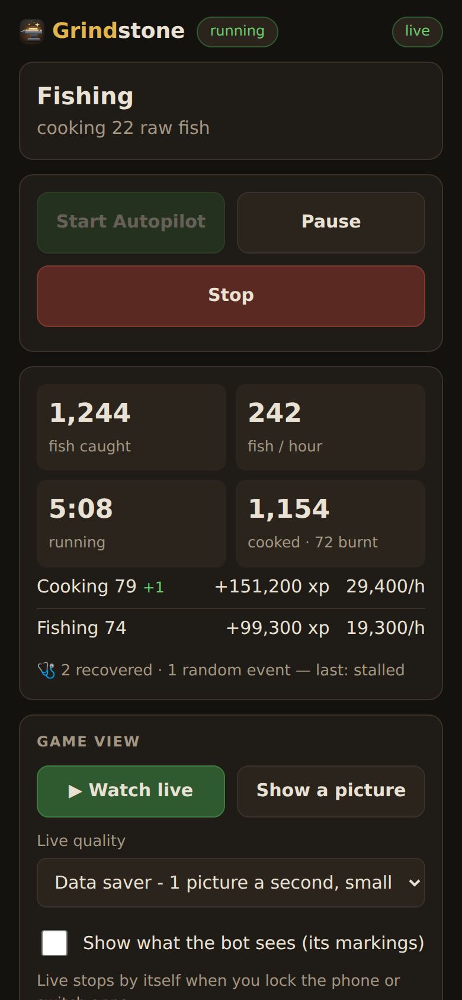

# Grindstone on your phone

<p align="center"></p>

Check on the bot and start, pause or stop it from your phone, even when you're out, and get a
notification when something needs you.

The panel has no password and can control your game, so **never** open its port on your router
or put it on a public tunnel (ngrok, Tailscale Funnel...). Tailscale keeps it private: only your
own devices can reach it.

## 1. Reach the panel with Tailscale

1. Install [Tailscale](https://tailscale.com/download) on the PC and on your phone, and sign in to
   the same account on both.
2. On the PC, open Command Prompt and run:
   ```
   tailscale serve --bg 8765
   ```
   It prints your panel's private address, like `https://my-pc.tail1234.ts.net`. This only needs
   doing once - it comes back after a restart.
3. On your phone (Tailscale switched on), open that address. Phones get the **phone layout**
   (`/m`); *Full panel* at the bottom opens the whole panel. Add it to your home screen for a
   one-tap shortcut.

The phone layout shows what the bot is doing, its totals and XP, the activity log and the game:
**▶ Watch live** shows it live (Data saver, about 1 picture a second, is the default; Normal and
Smooth look better and use more data - the page shows how much). Live stops by itself when you
lock the phone or switch apps. Tap the picture for full screen. **Start** starts the task as it was last
set up on the PC; **Start plan** starts the saved plan. Stop asks first, so a pocket tap can't end
a long run.

To turn it off again: `tailscale serve --bg off` (or `tailscale serve reset`).

## 2. Notifications (ntfy)

1. Install the free **ntfy** app (Play Store / App Store).
2. In the phone layout open **🔔 Phone notifications**. Grindstone has made up a random topic
   name - in the ntfy app tap **+** and subscribe to exactly that topic.
3. Tick **Turn on**, choose what you want to hear about, and **Save**. **Send a test** checks it.
4. Put your Tailscale address (ending in `/m`) under *Open this when a notification is tapped*
   and a notification opens the panel.

You can be told when:

- **the bot stops by itself** - finished, crashed, gave up (not when you press Stop)
- **something needs you** - the game froze, a step was given up, auto login is paused, your
  character keeps dying, or the game window is minimized (the bot waits until it isn't)
- **a skill levels up**
- **every few hours** - a progress summary while it runs

Each kind of problem is sent at most once every 30 minutes. Only the bot's status is sent (what
stopped and why, levels, totals) - never your game login. The topic name works like a password:
anyone who knows it can read the messages, so keep the random one.

## If it doesn't connect

- **The page opens but says *offline*, or the log and totals never change:** update Grindstone
  (versions before the phone layout can't keep their live connection over Tailscale's https
  address). Then reload the page.
- **The page doesn't open at all:**
  1. Open the Tailscale app on the phone: it must say *Connected*, on the same account as the PC,
     with the PC in its list.
  2. Use the exact address `tailscale serve` printed, starting with `https://`. The very first
     visit can take up to a minute while Tailscale sets up its certificate - try once more.
  3. **502 Bad Gateway** means Grindstone isn't running on the PC.
  4. Another VPN, an ad blocker or Android's *Private DNS* can block Tailscale - turn it off and
     try again.
  5. Open the same address in a browser on the PC. Works there? The problem is on the phone side.
- **No notifications:** press **Send a test**. If it says sent but nothing arrives, check the
  topic in the ntfy app is exactly the one on the page, and that ntfy may show notifications
  (phone settings → Apps → ntfy). Battery savers can delay them - set ntfy to *unrestricted*.
- **Live view says it can't see the game:** the game window is closed or minimized.

## Before you go out

- Settings → System → Power: set the PC never to sleep while plugged in.
- Don't minimize the game window - the bot waits while it is. Behind other windows, or the
  screen switched off, is fine.
